<div align="center">
  <picture>
    <source media="(prefers-color-scheme: dark)" srcset="./images/siteicons/diamonwhite.svg">
    <source media="(prefers-color-scheme: light)" srcset="./images/siteicons/diamon.svg">
    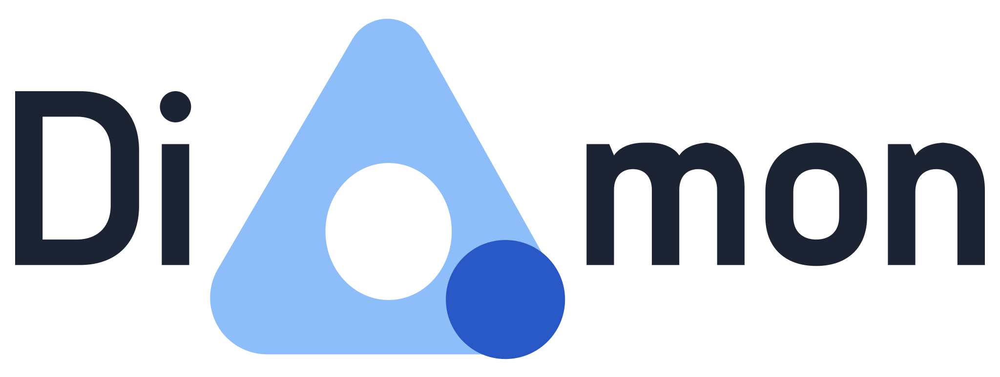
  </picture>

  <p>Diamon: Open-Source Personal Subscription Tracker</p>

  [](https://github.com/ellite/Wallos)
  [](LICENSE.md)
</div>

> Diamon is a customised fork of [Wallos](https://github.com/ellite/Wallos), the open-source subscription tracker
> created by [Henrique (ellite)](https://henrique.pt) and its contributors. It is distributed under the same
> GNU GPLv3 licence. All credit for the original application goes to the Wallos project - see [Credits](#credits).


## Table of Contents

- [Introduction](#introduction)
- [Features](#features)
- [Demo](#demo)
- [Getting Started](#getting-started)
  - [Prerequisites](#prerequisites)
    - [Baremetal](#baremetal)
    - [Docker](#docker)
  - [Installation](#installation)
    - [Baremetal](#baremetal-1)
      - [Updating](#updating)
    - [Docker](#docker-1)
    - [Docker-Compose](#docker-compose)
- [Usage](#usage)
- [Screenshots](#screenshots)
- [OIDC](#oidc)
- [API Documentation](#api-documentation)
- [Contributing](#contributing)
  - [Upstream contributors](#upstream-contributors)
  - [Translations](#translations)
- [License](#license)
- [Credits](#credits)
- [Links](#links)

## Introduction

Diamon is a powerful, open-source, and self-hostable web application designed to empower you in managing your finances with ease. Say goodbye to complicated spreadsheets and expensive financial software – Diamon simplifies the process of tracking expenses and helps you gain better control over your financial life.

## Features

- Subscription Management: Keep track of your recurring subscriptions and payments, ensuring you never miss a due date.
- Category Management: Organize your expenses into customizable categories, enabling you to gain insights into your spending habits.
- Multi-Currency support: Diamon supports multiple currencies, allowing you to manage your finances in the currency of your choice.
- Currency Conversion: Integrates with the Fixer API so you can get exchange rates and see all your subscriptions on your main currency.
- Data Privacy: As a self-hosted application, Diamon ensures that your financial data remains private and secure on your own server.
- Customization: Tailor Diamon to your needs with customizable categories, currencies, themes and other display options.
- Sorting Options: Allowing you to view your subscriptions from different perspectives.
- Logo Search: Diamon can search the web for the logo of your subscriptions if you don't have them available for upload.
- Mobile view: Diamon on the go.
- Statistics: Another perspective into your spendings.
- Notifications:  Diamon supports multiple notification methods (email, discord, pushover, telegram, gotify and webhooks). Get notified about your upcoming payments.
- Multi Language support.
- OIDC with OAuth
- AI Recommendations with ChatGPT, Gemini or Local Ollama

## Demo

Diamon has no public demo of its own. The upstream Wallos demo, which shows the application Diamon is built on, is available at [https://demo.wallosapp.com](https://demo.wallosapp.com).  
The database is reset every 2 hours.  
To access the demo use the following credentials:

```python
Username: demo  
Password: demo
```

## Getting Started

See instructions to run Diamon below.

### Prerequisites

#### Baremetal

- NGINX or APACHE websever running
- PHP 8.3 with the following modules enabled:
    - curl
    - dom
    - gd
    - intl
    - openssl
    - sqlite3
    - zip
    - mbstring
    - fpm

#### Docker

- Docker

### Installation

#### Baremetal

1. Download or clone this repo and move the files into your web root - usually `/var/www/html`
2. Rename `/db/wallos.empty.db` to `/db/wallos.db` (the database file keeps its upstream name so existing installations and backups keep working)
3. Open the app in your browser — migrations run automatically on the registration page
4. Add the following scripts to your cronjobs with `crontab -e`

```bash
0 1 * * * php /var/www/html/endpoints/cronjobs/updatenextpayment.php >> /var/log/cron/updatenextpayment.log 2>&1
0 2 * * * php /var/www/html/endpoints/cronjobs/updateexchange.php >> /var/log/cron/updateexchange.log 2>&1
0 8 * * * php /var/www/html/endpoints/cronjobs/sendcancellationnotifications.php >> /var/log/cron/sendcancellationnotifications.log 2>&1
0 9 * * * php /var/www/html/endpoints/cronjobs/sendnotifications.php >> /var/log/cron/sendnotifications.log 2>&1
*/2 * * * * php /var/www/html/endpoints/cronjobs/sendverificationemails.php >> /var/log/cron/sendverificationemail.log 2>&1
*/2 * * * * php /var/www/html/endpoints/cronjobs/sendresetpasswordemails.php >> /var/log/cron/sendresetpasswordemails.log 2>&1
0 */6 * * * php /var/www/html/endpoints/cronjobs/checkforupdates.php >> /var/log/cron/checkforupdates.log 2>&1
30 1 * * 1 php /var/www/html/endpoints/cronjobs/storetotalyearlycost.php >> /var/log/cron/storetotalyearlycost.log 2>&1
30 3 * * 1 php /var/www/html/endpoints/cronjobs/generaterecommendations.php weekly >> /var/log/cron/generaterecommendations.log 2>&1
0 4 1 * * php /var/www/html/endpoints/cronjobs/generaterecommendations.php monthly >> /var/log/cron/generaterecommendations.log 2>&1
```

5. If your web root is not `/var/www/html/` adjust the cronjobs above accordingly.

#### Updating

1. Re-download the repo and move the files into the correct folder or do `git pull` (if you used git clone before)
2. Check the [Prerequisites](#baremetal) and install / enable the missing ones, if any.
3. Run http://domain.example/endpoints/db/migrate.php if you are logged in, or via CLI run:
```bash
php /var/www/html/endpoints/db/migrate.php
```

#### Docker

Diamon is not published to a public registry. Build the image from this repository first:

```bash
docker build -t diamon:latest .
```

Then run it:

```bash
docker run -d --name diamon -v /path/to/config/diamon/db:/var/www/html/db \
-v /path/to/config/diamon/logos:/var/www/html/images/uploads/logos \
-e TZ=Europe/Berlin -p 8282:80 --restart unless-stopped \
diamon:latest
```

Disable healthcheck (optional, e.g., for Docker <25 or faster startup reporting):

```bash
docker run -d --name diamon -v /path/to/config/diamon/db:/var/www/html/db \
-v /path/to/config/diamon/logos:/var/www/html/images/uploads/logos \
-e TZ=Europe/Berlin -p 8282:80 --restart unless-stopped \
--health-cmd=NONE \
diamon:latest
```

### Docker Compose

```
services:
  diamon:
    container_name: diamon
    build: .
    image: diamon:latest
    ports:
      - "8282:80/tcp"
    environment:
      TZ: 'America/Toronto'
    # Volumes store your data between container upgrades
    volumes:
      - './db:/var/www/html/db'
      - './logos:/var/www/html/images/uploads/logos'
    restart: unless-stopped
```

Disable healthcheck (optional, e.g., for Docker <25 or faster startup reporting):

```
services:
  diamon:
    container_name: diamon
    build: .
    image: diamon:latest
    ports:
      - "8282:80/tcp"
    environment:
      TZ: 'America/Toronto'
    volumes:
      - './db:/var/www/html/db'
      - './logos:/var/www/html/images/uploads/logos'
    restart: unless-stopped
    healthcheck:
      test: ["NONE"]
```

### Upgrading an existing Wallos installation

Diamon reads the same database (`db/wallos.db`), the same volumes (`/var/www/html/db` and
`/var/www/html/images/uploads/logos`) and the same backups as Wallos, so no data migration is needed.
Things that were renamed keep accepting their old name:

- Environment variables `WALLOS_SMTP_*` and `WALLOS_SERVER_URL` are still read when the new
  `DIAMON_SMTP_*` / `DIAMON_SERVER_URL` variables are not set.
- Existing "remember me" sessions (`wallos_login` cookie) stay signed in and are moved to the new cookie.
- The browser extension picks up the server address saved by earlier versions.

If you run the bundled `docker-compose.yaml`, the service and container are now called `diamon`; recreate
them once with `docker compose up -d --build --remove-orphans` so the old `wallos` container is replaced.

## Usage

Just open the browser and open `ip:port` of the machine running Diamon.  
On the first time you run Diamon a user account must be created.  
Go to settings and personalise your Avatar and add members of your household. While there add / remove any categories and currencies.  
Get a free API Key from [Fixer](https://fixer.io/#pricing_plan) and add it in the settings.  
If you want to trigger an Update of the exchange rates, change your main currency after adding the API Key, and then change it back to your preferred one.  

## Screenshots

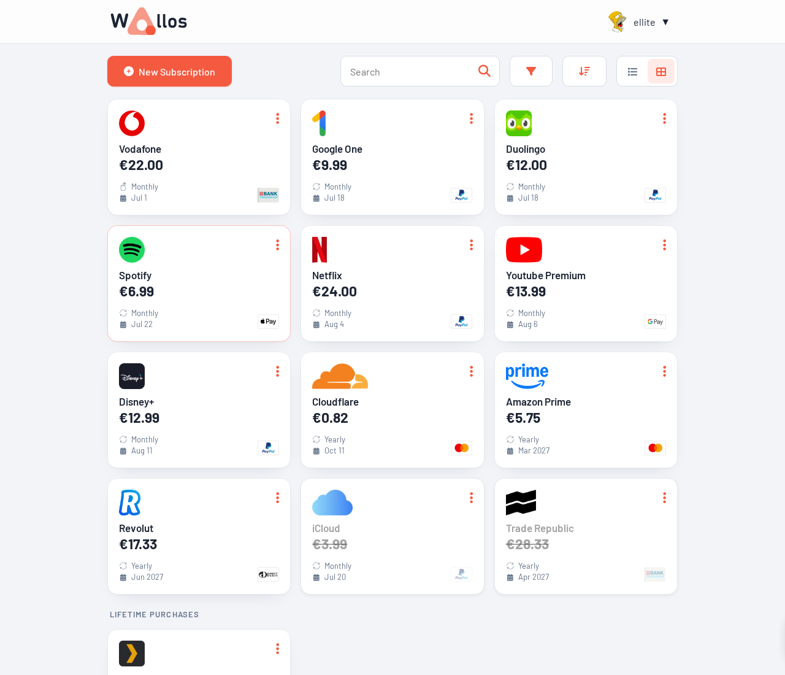

<details>
<summary>See more screenshots</summary>

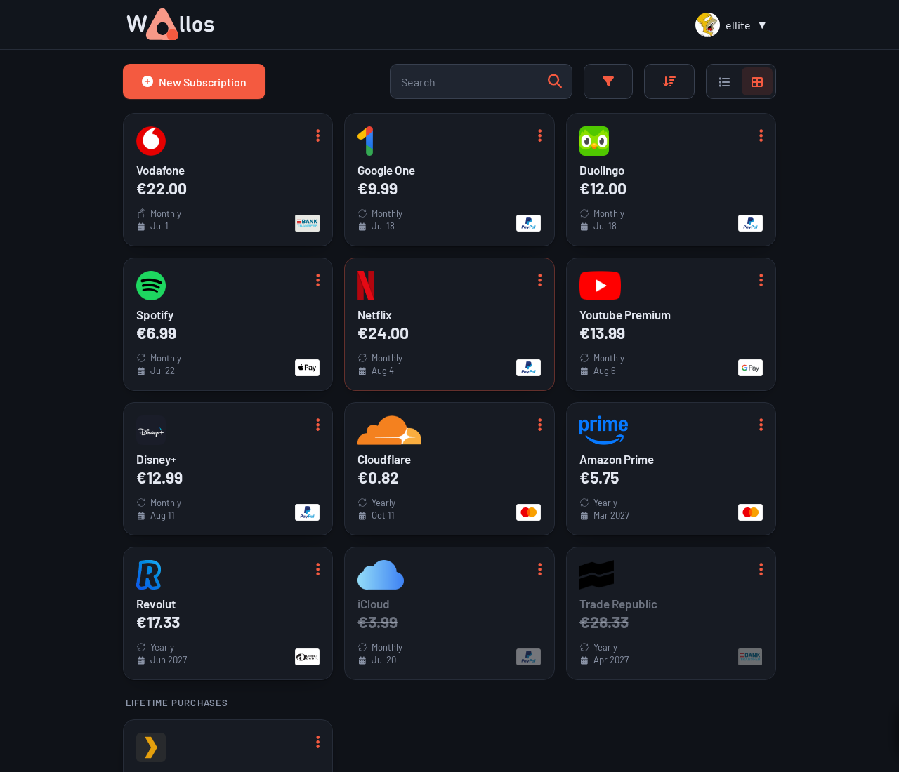

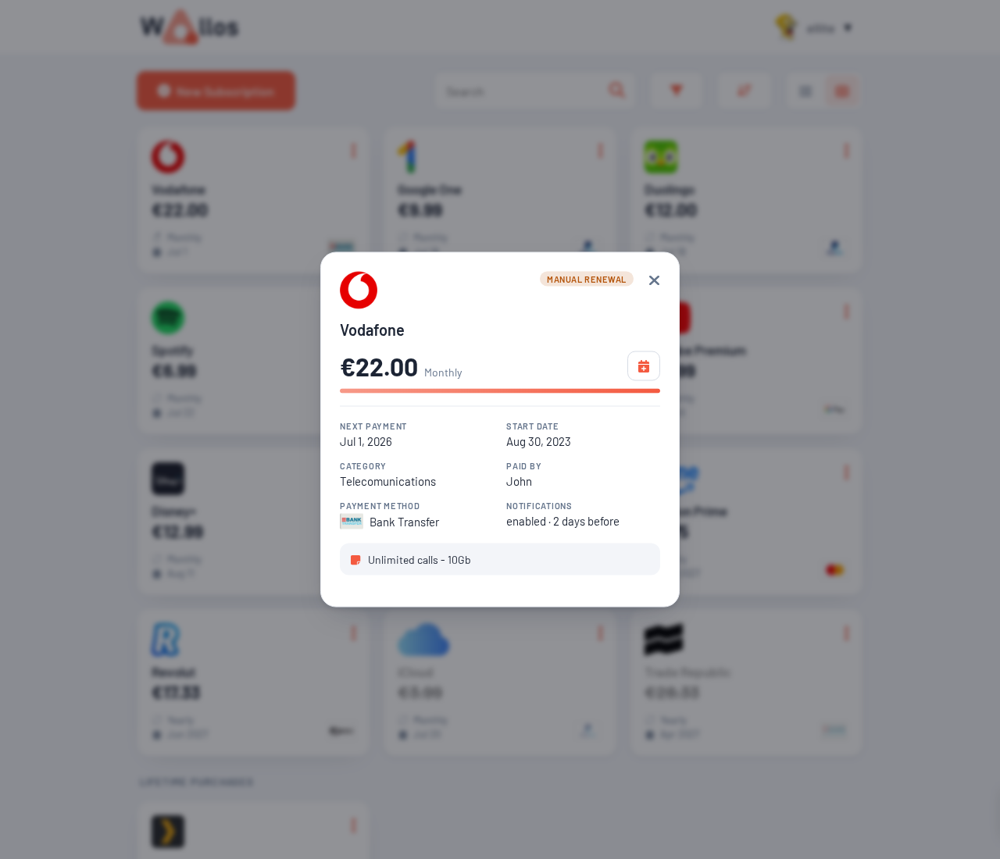

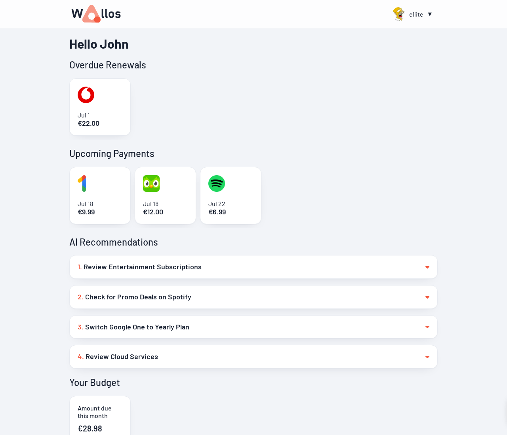

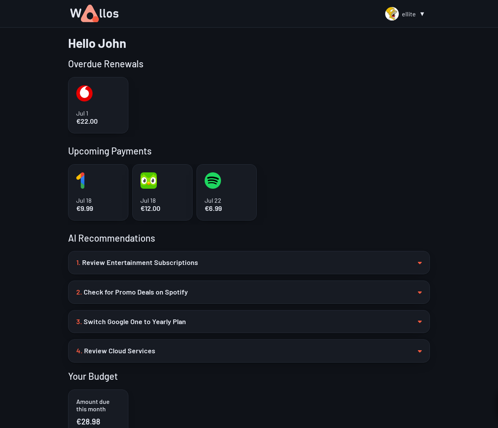

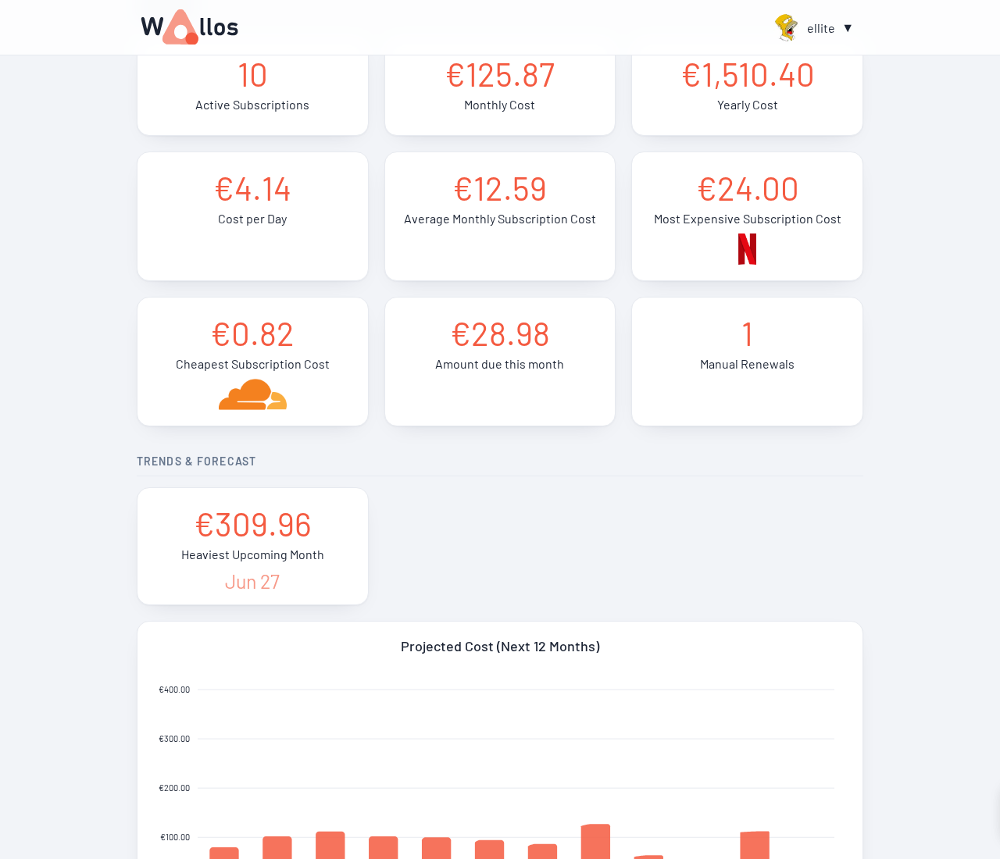

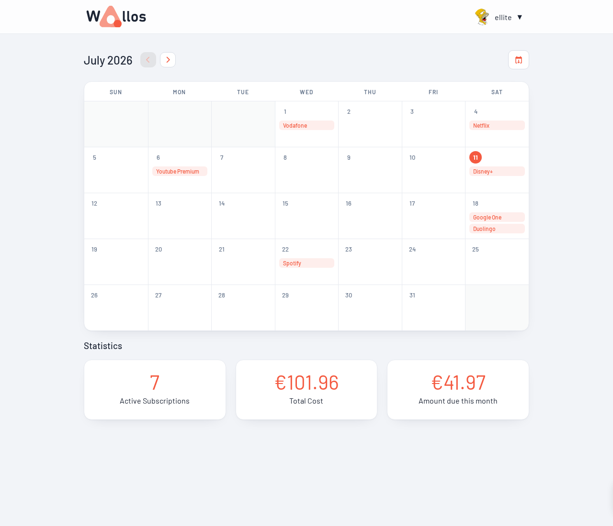

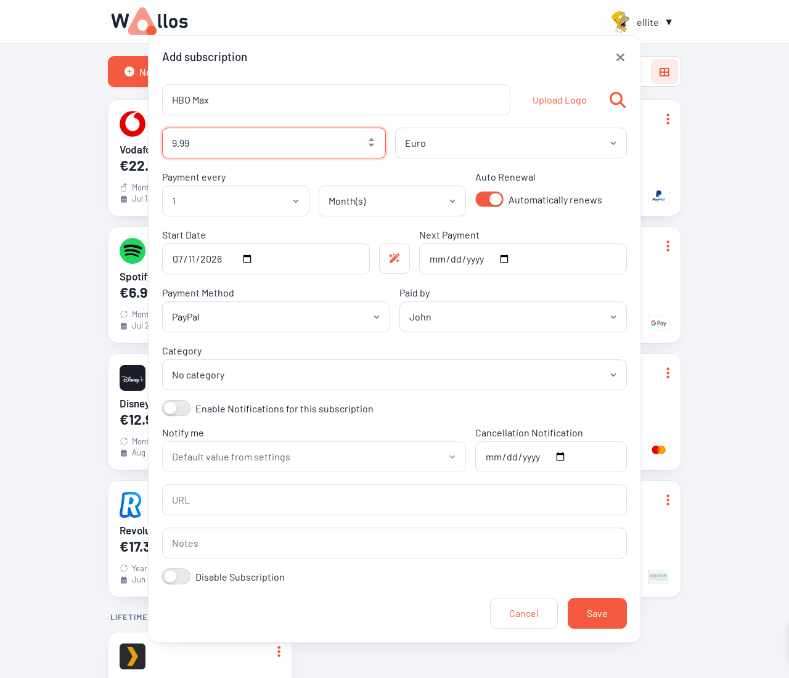

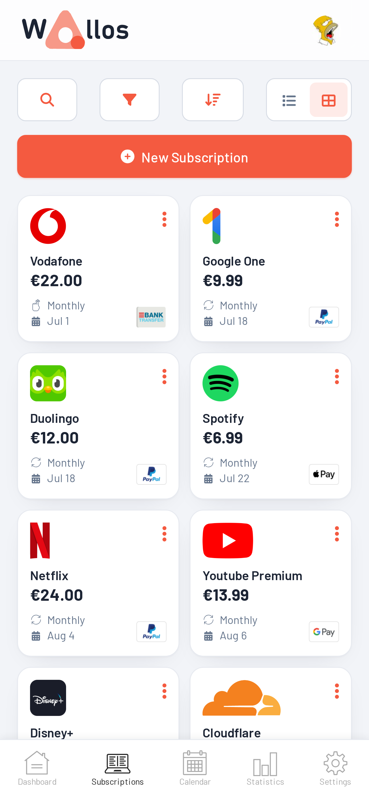 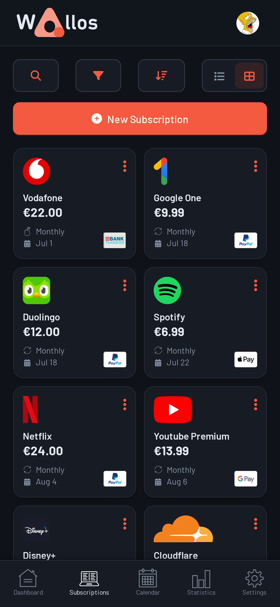

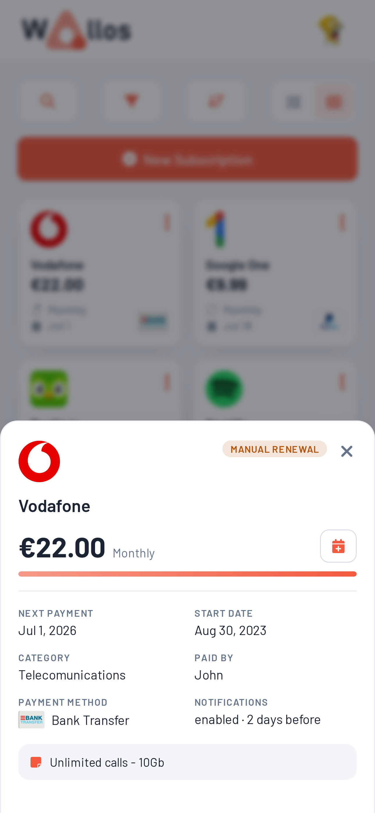

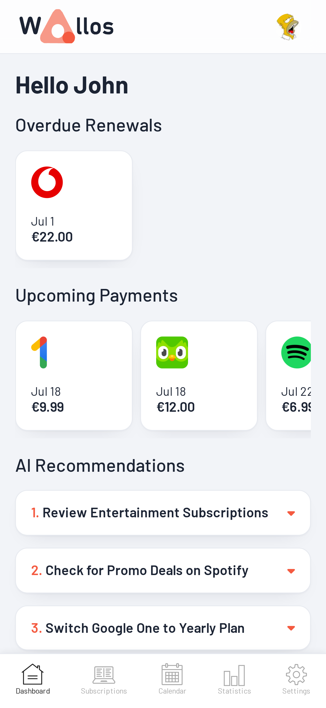 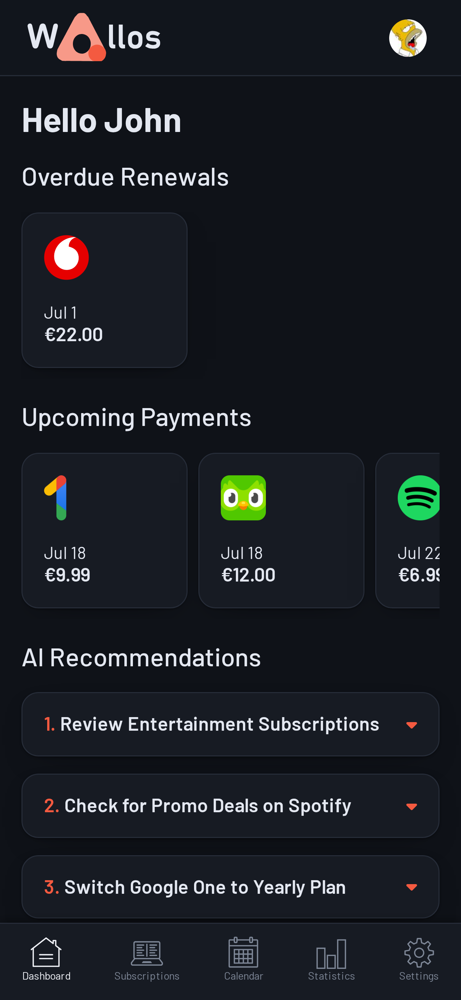

</details>

## OIDC

OIDC can be enabled on the Admin page and can be used with providers that support OAuth.
Diamon can also resolve OIDC settings declaratively from environment variables. When an `OIDC_*` variable is set, it overrides the corresponding database value at runtime without rewriting the database.

If `OIDC_ISSUER` is set, Diamon will fetch `/.well-known/openid-configuration` at runtime and use discovery for the authorization, token, and user info endpoints unless a more specific endpoint variable is also set.

| Environment Variable | UI Equivalent |
| --- | --- |
| `OIDC_ENABLED` | `Enable OIDC/OAuth` |
| `OIDC_PROVIDER_NAME` | `Provider Name` |
| `OIDC_CLIENT_ID` | `Client ID` |
| `OIDC_CLIENT_SECRET` | `Client Secret` |
| `OIDC_CLIENT_SECRET_FILE` | `Client Secret` |
| `OIDC_ISSUER` | No direct UI field |
| `OIDC_AUTH_URL` | `Auth URL` |
| `OIDC_TOKEN_URL` | `Token URL` |
| `OIDC_USERINFO_URL` | `User Info URL` |
| `OIDC_REDIRECT_URL` | `Redirect URL` |
| `OIDC_LOGOUT_URL` | `Logout URL` |
| `OIDC_USER_IDENTIFIER` | `User Identifier Field` |
| `OIDC_SCOPES` | `Scopes` |
| `OIDC_AUTO_CREATE_USER` | `Create user automatically` |
| `OIDC_DISABLE_PASSWORD_LOGIN` | `Disable password login` |
| `OIDC_REQUIRE_EMAIL_VERIFIED` | `Require verified email for account linking` |

### SSRF allowlist

Diamon blocks webhook, SMTP, and OIDC endpoint URLs that resolve to private/link-local/loopback addresses unless the host is present in the Security Settings allowlist. Normally that allowlist is edited through the Admin UI, which requires a manual login before OIDC can be used against an identity provider on a private address (e.g. a self-hosted IdP at `auth.example.com`).

Setting the `SSRF_ALLOWLIST` environment variable overrides the database value entirely (same full-override semantics as the `OIDC_*` variables above), so the allowlist can be provisioned on first boot with no manual UI step. It accepts a comma-separated list of hosts/IPs, optionally with a port (e.g. `SSRF_ALLOWLIST=auth.example.com,192.168.1.100:8123`). While set, the Security Settings field in the Admin UI is shown but disabled.

## API Documentation

Diamon provides a comprehensive API that allows you to interact with the application programmatically. Diamon keeps the Wallos API, so the upstream documentation at [https://api.wallosapp.com/](https://api.wallosapp.com/) applies.

## Contributing

Feel free to open Pull requests with bug fixes and features. I'll do my best to keep an eye on those.  
Feel free to open issues with bug reports or feature requests. Bug fixes will take priority.  
I welcome contributions from the community and look forward to working with you to improve this project.

### Upstream contributors

Diamon builds on the work of everyone who contributed to Wallos:

<a href="https://github.com/ellite/wallos/graphs/contributors">
  
</a>

### Translations

If you want to contribute with a translation of Diamon:
- Add your language code to `includes/i18n/languages.php` in the format `"en" => ["name" => "English", "dir" => "ltr"],`. Please use the original language name and not the english translation.
- Create a copy of the file `includes/i18n/en.php` and rename it to the language code you used above. Example: pt.php for "pt" => ["name" => "Português", "dir" => "ltr"],.
- Translate all the values on the language file to the new language. (Incomplete translations will not be accepted).
- Create a copy of the file `scripts/i18n/en.js` and rename it to the language code you used above. Example: pt.js for "pt" => ["name" => "Português", "dir" => "ltr"],.
- Translate all the values on the language file to the new language. (Incomplete translations will not be accepted).

## License

This project is licensed under the [GNU General Public License, Version 3](LICENSE.md) - see the [LICENSE.md](LICENSE.md) file for details.

### Why GPLv3?

I chose the GNU General Public License version 3 (GPLv3) for this project because it ensures that the software remains open source and freely available to the community. GPLv3 mandates that any derivative works or modifications must also be released under the same license, promoting the principles of software freedom.

I strongly believe in the importance of open source software and the collaborative nature of development, and I invite contributors to help improve this project.

## Credits

Diamon is derived from [Wallos](https://github.com/ellite/Wallos), copyright its author
[Henrique (ellite)](https://henrique.pt) and the Wallos contributors, and is released under the
[GNU General Public License v3](LICENSE.md) like the original. The history of the upstream project is kept in
[CHANGELOG.md](CHANGELOG.md).

## Links

- Original Wallos project: [github.com/ellite/Wallos](https://github.com/ellite/Wallos)
- Wallos author: [henrique.pt](https://henrique.pt)
- Wallos landing page: [wallosapp.com](https://wallosapp.com)
